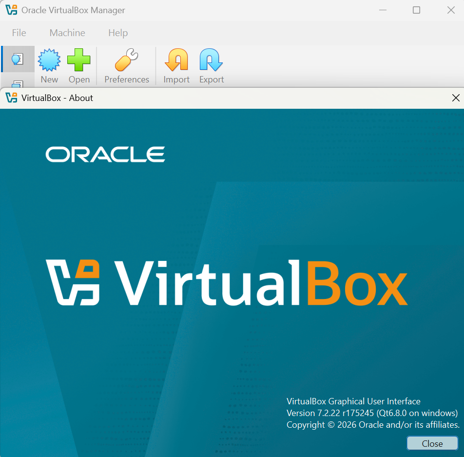
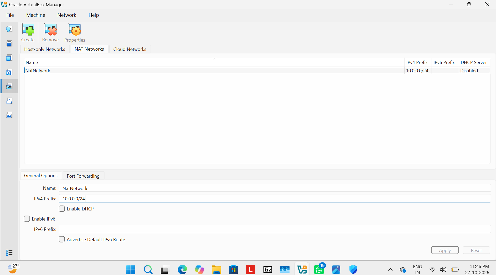
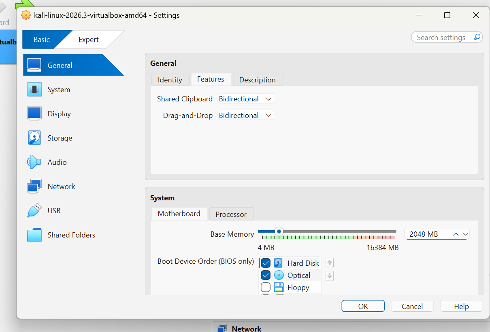
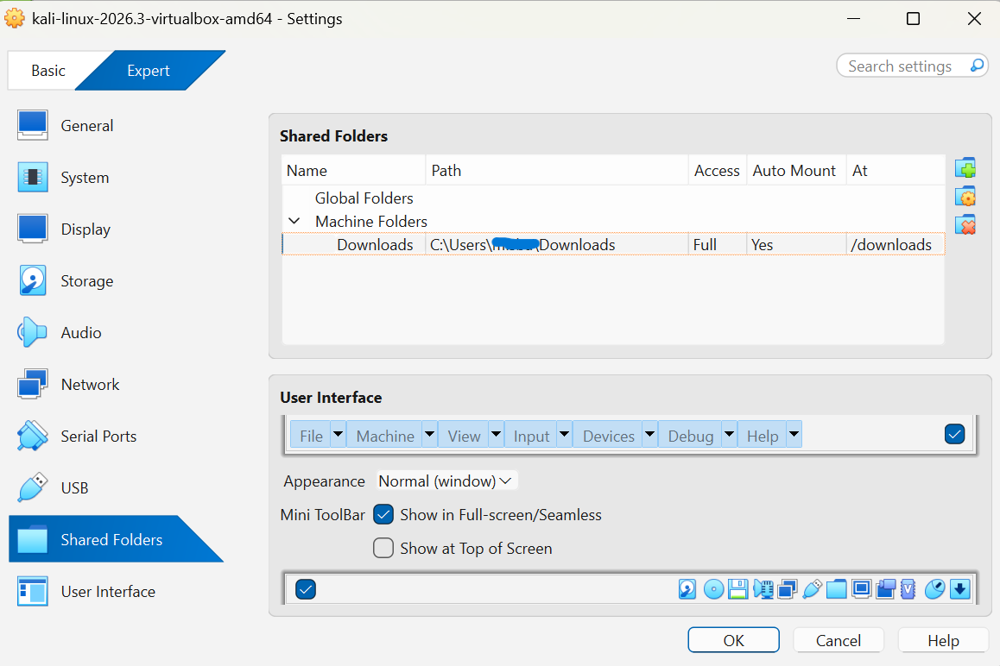
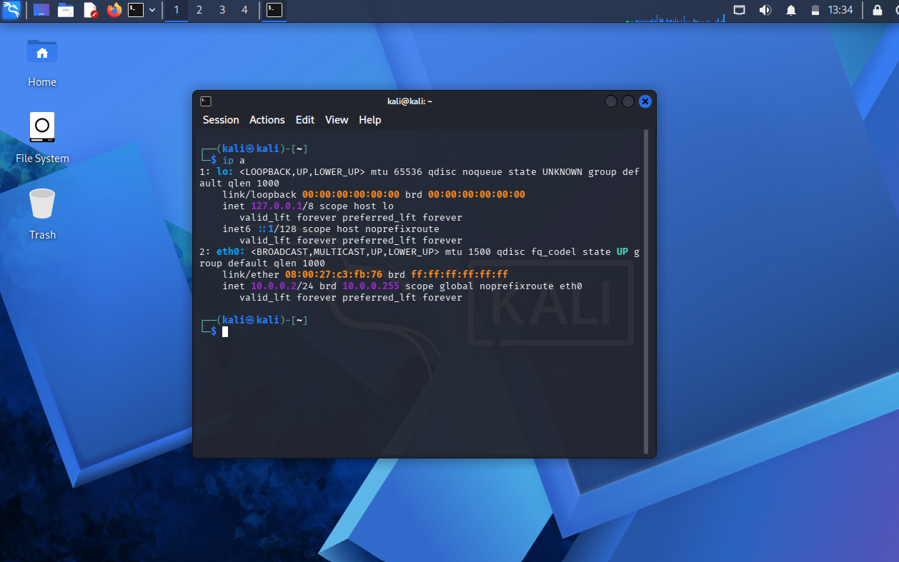
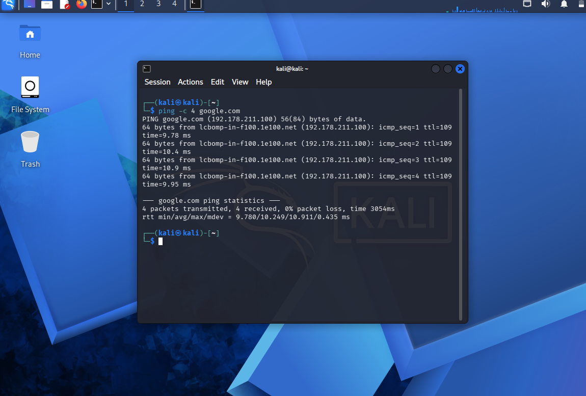
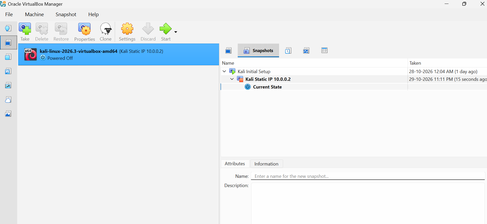

# Cybersecurity Lab Setup: VirtualBox + Kali Linux

A private virtual lab for learning cybersecurity and ethical hacking, built with VirtualBox and Kali Linux.

## Project Overview

This project documents how I built the first part of my cybersecurity lab for Week 1 of the Network Walks internship. The lab uses VirtualBox as the hypervisor and Kali Linux as the attacker machine, connected to a private NAT Network (`10.0.0.0/24`). More machines can be added to the same network later as practice targets.

## Objectives

- Install 7-Zip and VirtualBox
- Create a NAT Network with the subnet `10.0.0.0/24`
- Import Kali Linux as the attacker VM
- Enable the shared clipboard, drag-and-drop and a shared folder
- Give Kali the static IP `10.0.0.2/24` with full internet access
- Verify connectivity with `ip a` and `ping`
- Take a snapshot so the VM can be restored to a clean state
- Document every step

## Lab Configuration

| Component | Configuration |
|---|---|
| Host OS | Windows (laptop: _add model and RAM_) |
| Hypervisor | VirtualBox 7.2.22 |
| Attacker VM | Kali Linux 2026.3 (64-bit, pre-built VirtualBox image) |
| Kali RAM / CPUs | 2048 MB / 2 processors |
| Video memory | 128 MB |
| Virtual network | NAT Network `NatNetwork` |
| Network address | 10.0.0.0/24 |
| DHCP | Disabled (static addressing) |
| Adapter type | Intel PRO/1000 MT Desktop (82540EM) |
| Promiscuous mode | Allow All |
| Kali IP address | 10.0.0.2/24 |
| Default gateway | 10.0.0.1 |
| DNS server | 8.8.8.8 |
| Clipboard / Drag-and-Drop | Bidirectional |
| Shared folder | Windows Downloads folder, mounted at `/downloads` |

## Setup Procedure

### Step 1. Install 7-Zip

7-Zip was installed to extract the Kali Linux image, which is downloaded as a `.7z` archive.


### Step 2. Install VirtualBox

I installed the latest recommended version of VirtualBox from virtualbox.org. The About window shows version 7.2.22.



### Step 3. Create the NAT Network

In VirtualBox: **File → Tools → Network Manager → NAT Networks → Create**.

- Name: `NatNetwork`
- IPv4 Prefix: `10.0.0.0/24`
- DHCP: disabled, because Kali uses a static IP
- IPv6: disabled

A NAT Network lets every VM on it reach the internet and also talk to the other VMs on the same network. That is what a lab with an attacker machine and target machines needs.



### Step 4. Import Kali Linux

I downloaded the pre-built Kali VirtualBox image from kali.org, extracted it with 7-Zip, and opened the `.vbox` file to add the VM to VirtualBox.


### Step 5. Attach Kali to the NAT Network

In the VM's **Settings → Network → Adapter 1**:

- Attached to: NAT Network
- Name: `NatNetwork`
- Adapter Type: Intel PRO/1000 MT Desktop
- Promiscuous Mode: Allow All
- Cable Connected: ticked


### Step 6. Enable Shared Clipboard and Drag-and-Drop

In **Settings → General → Features**, I set both **Shared Clipboard** and **Drag-and-Drop** to **Bidirectional**. This lets me copy text and drag files between Windows and Kali.



### Step 7. Create the Shared Folder

In **Settings → Shared Folders → Add**, I shared my Windows Downloads folder:

- Folder Name: `downloads`
- Mount point: `/downloads`
- Auto-mount and Make Permanent: ticked

Then inside Kali I added my user to the `vboxsf` group so it can read the folder:

```bash
sudo usermod -aG vboxsf kali
sudo reboot
```

After the reboot, `ls /downloads` lists the files from my Windows Downloads folder.



### Step 8. Set the Static IP Address in Kali

I set the address in the network connection editor (**IPv4 Settings**):

- Method: Manual
- Address: `10.0.0.2`
- Netmask: `24`
- Gateway: `10.0.0.1`
- DNS: `8.8.8.8`


The same settings can be applied from the terminal:

```bash
sudo nmcli con mod "Wired connection 1" ipv4.method manual \
  ipv4.addresses 10.0.0.2/24 ipv4.gateway 10.0.0.1 ipv4.dns 8.8.8.8
sudo nmcli con up "Wired connection 1"
```

### Step 9. Verify the Network

`ip a` shows `10.0.0.2/24` on `eth0`:



`ping -c 4 google.com` gets replies, so internet access and DNS both work:



### Step 10. Take a Snapshot

After everything worked, I took a snapshot in VirtualBox (**Machine → Take Snapshot**). If a later experiment breaks the VM, I can restore it to this clean state.



## Lab Verification

| Test | Command | Result |
|---|---|---|
| Check IP address | `ip a` | `eth0` has `10.0.0.2/24` |
| Gateway reachable | `ping -c 3 10.0.0.1` | Replies received |
| Internet and DNS | `ping -c 4 google.com` | 4 sent, 4 received, 0% packet loss |
| Shared folder | `ls /downloads` | Windows Downloads files listed |

## Problems I Faced and How I Fixed Them

**Kali showed "Network disconnected" and `nmcli con up` failed** with *IP configuration could not be reserved*. The connection stayed on "connecting (getting IP configuration)" even though the saved values were correct. I disabled IPv6 on the connection, turned off the duplicate-address check, and restarted NetworkManager:

```bash
sudo nmcli con mod "Wired connection 1" ipv6.method disabled ipv4.dad-timeout 0
sudo systemctl restart NetworkManager
```

After that `eth0` came up with `10.0.0.2/24` and the pings worked.

## What I Learned

1. **A NAT Network is different from a plain NAT adapter.** A plain NAT adapter only gives one VM access to the internet. A NAT Network also lets the VMs on it reach each other, which a lab needs.
2. **Static IP vs DHCP.** With DHCP turned off on the NAT Network, Kali only got connectivity once I entered the address, netmask, gateway and DNS myself. This made it clear what each of those four values does.
3. **Troubleshooting networks step by step.** I learned to read `nmcli` output and to check the adapter, the saved settings and the connection state one at a time, instead of changing everything at once.
4. **Snapshots are a safety net.** I can try risky things later and return to a working lab in one click.
5. **Documenting while building** is much easier than trying to remember the steps afterwards.

## Security and Ethical Use

This lab is for learning only. I will only test systems that I own or have explicit permission to test.

## Tools and Resources

- 7-Zip: https://7-zip.org/download.html
- VirtualBox: https://virtualbox.org/wiki/Downloads
- Kali Linux: https://kali.org/get-kali

## Author

**Simra Shaikh**, Cybersecurity intern, Network Walks

## Project Information

Program: Cybersecurity at Network Walks | Week: 01 | Project: Cybersecurity and Pentesting Lab Setup | Platform: GitHub
